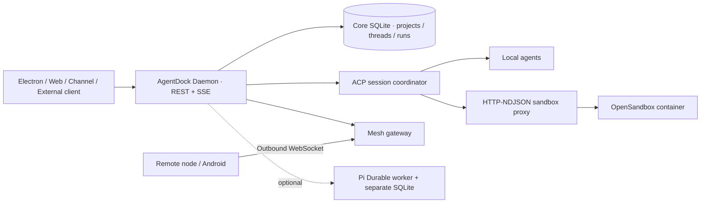

# AgentDock

**An agent execution workbench powered by a standalone Daemon, Agent Client Protocol (ACP), optional OpenSandbox and connected Mesh devices.**

[中文 README](README.md) · [Public architecture](docs/architecture/public-overview.md) · [Session recovery case](docs/guides/agent-session-recovery.md) · [Runnable cloud sandbox demo](docs/demos/cloud-sandbox.md)

AgentDock is an open-source TypeScript/pnpm monorepo. Run it as an Electron desktop app or a standalone Daemon with a React web interface. Other systems can submit prompts through the external API without opening Electron.

## Capabilities

- **Runtime orchestration:** ACP session lifecycle for supported local agents such as Pi, Codex, Claude Code and Hermes (availability depends on installed/configured runtimes).
- **Daemon-owned state:** workspaces, threads, submissions, runs, SQLite history, approvals, streaming progress and events.
- **Background workflows:** Lark/Feishu, Weixin, Butler, scheduler and automation.
- **Sandbox execution:** optional OpenSandbox containers with HTTP-NDJSON ACP transport and scoped workspace/agent-state mounts.
- **Device execution:** AgentDock Mesh outbound connections and scoped remote tools, distinct from ACP runs.
- **External API:** external project/thread mapping, submit run, per-run SSE and OpenAI-compatible Chat Completions adapter.
- **Opt-in Pi Durable:** a separate constrained worker plus SQLite store for supported checkpoint/reconciliation semantics, not general-purpose arbitrary tool replay.

## Architecture



The **Daemon is the control plane**. Electron manages the window, not agent execution. The web UI uses the SDK to call the Daemon. Agent runtime processes/containers execute work. The Mesh device plane executes explicitly authorized device operations. Session, run, submission, external identity and Mesh operation IDs are different identifiers with different guarantees.

Read the [English architecture walkthrough](docs/architecture/public-overview.md), [canonical architecture facts](docs/architecture.md), [interactive architecture diagram](docs/architecture/system-architecture.html), and [L1–L3 architecture matrix](docs/architecture/overview.md).

## Quick start

### Desktop

Install a compatible Node.js version, pnpm and any real agent runtimes/providers you intend to use:

```bash
pnpm install
pnpm dev
```

Daemon-only mode:

```bash
pnpm build:electron
pnpm start:daemon
```

### Docker Compose / cloud sandbox

A trusted machine with Docker Engine and Compose v2 is required.

```bash
docker compose up --build -d
curl -fsS http://127.0.0.1:9831/api/local/v1/health
```

| Service | Local address |
| --- | --- |
| AgentDock Web | http://127.0.0.1:14173 |
| Daemon API | http://127.0.0.1:9831/api/local/v1 |
| OpenSandbox | http://127.0.0.1:8080 |

**Reproducible end-to-end example:** see [Cloud Sandbox demo](docs/demos/cloud-sandbox.md) and run `pnpm e2e:compose`. It builds the fake ACP image, starts the stack, performs an external run, observes per-run SSE, and verifies the SQLite-backed thread result. **No real model key required.**

> **Development security warning:** the sample Compose stack mounts the host Docker socket into OpenSandbox and uses a permissive local configuration. It is not a hardened, internet-exposed or multi-tenant deployment. Default published ports are loopback-only; keep them private.

## Session recovery is not the same as tool replay

| Case | Guarantee / limit |
| --- | --- |
| Reopen a thread | Persisted Core history and thread snapshots are available |
| Recreate a traditional ACP process | Attempt `session/load` when supported and safe; otherwise `session/new` |
| Process crash during a side-effecting tool | **No automatic exactly-once continuation or blind replay** |
| Opt-in Pi Durable | Supported checkpoint/submission reconciliation, under narrower runtime/tool capabilities |
| Mesh reconnect | Retrieve saved node-local receipts by stable operation ID; pre-receipt crash window remains uncertain |

See the [technical case study](docs/guides/agent-session-recovery.md).

## Repository map

- `apps/daemon`: API, persistence, ACP, sandbox, Mesh, channels and scheduler
- `apps/desktop`: Electron desktop shell
- `apps/web`: React renderer
- `packages/contracts`, `packages/sdk`: cross-process contracts and client SDK
- `docs/architecture`: current architecture, diagrams and change records
- `scripts/e2e-compose.mjs`: real Compose + sandbox integration assertions

## Testing

```bash
pnpm typecheck
pnpm test:ci
pnpm verify
pnpm e2e:compose
```

`pnpm verify` may need the Archify CLI locally for `lint:arch`; CI provisions a pinned toolchain. The Compose test requires Docker. This README does not claim live-provider testing or a production security audit.

[Documentation index](docs/README.md) · [License](LICENSE.md)
