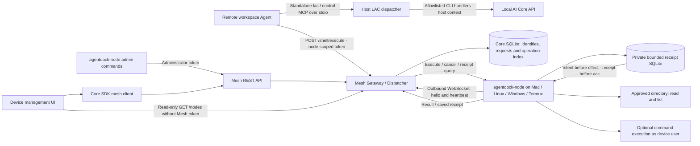

# AgentDock Mesh v1

Mesh adds device tool execution to Local AI Core. ACP sessions, threads and agent tasks retain their existing execution paths. A Mesh request is a separate operation with its own identity and history; it is not an ACP run or an agent runtime installation.



## Ownership and transport

- Contracts: `packages/contracts/src/mesh.ts`; API client: `packages/sdk/src/mesh.ts`.
- Core owns identities, allowed capabilities, execution history, the stable operation-ID index and per-node receipt-query cursors in `mesh_nodes`, `mesh_executions`, `mesh_operations` and `mesh_recovery_cursors`, in the existing `runtime/local-core.db`. Only hashes of pairing and device credentials are retained; operation arguments are represented in the index by a canonical digest.
- `MeshGateway` attaches to the existing Core HTTP server. Nodes initiate WebSocket connections, so devices need no inbound listener or public IP. Internet, LAN and Tailscale are transport choices; no specific overlay is required.
- `bin/agentdock.mjs` forwards the Mesh WebSocket upgrade through the bundled web server, in addition to existing REST forwarding.
- The node owns its approved root, local credentials, command opt-in and optional receipt journal. The CLI stores receipts in a private `.agentdock-mesh-receipts/` directory beside the configured state file; POSIX directories use mode 0700 and databases use mode 0600. The journal is bounded to 200 entries, seven days of result retention, 2 MiB per result and 16 MiB total result/reservation bytes. Credentials are created exclusively with mode 0600; existing files are not overwritten. Use an operating-system ACL on Windows to restrict credential and receipt files to the node user (POSIX mode bits do not establish a Windows ACL).
- The renderer owns temporary UI state. The Mesh page reads node overview data without the Mesh admin token and refreshes every three seconds. It does not expose administrative controls.

## Trust boundaries

Mesh is disabled unless `AGENTDOCK_MESH_ADMIN_TOKEN` is set. Generate a high-entropy random value and supply it securely to Core and administration clients. This token protects Mesh management endpoints; it does not add authentication to pre-existing Core APIs. While Mesh is enabled, `GET /mesh/nodes` returns node ID, label, platform, advertised and allowed capabilities, presence and timestamps to anyone who can reach the Core route. `POST /mesh/shell/execute` instead requires a signed, expiring launch token and accepts only the bound node's `shell.exec`; all other management routes remain administrator-authenticated. Protect the complete Core surface when deploying publicly.

An administrator creates a device-specific, single-use pairing token valid for ten minutes. `/enroll` exchanges it for the device credential. The first WebSocket message supplies that credential; protocol v1 accepts only text messages, known capabilities and bounded payloads. A node cannot act as an administrator or finish another device's requests. Revocation invalidates both enrollment and connection credentials, closes the active connection and interrupts pending work.

The client requires HTTPS/WSS outside loopback, follows no redirects, and verifies TLS normally. `--allow-insecure` explicitly permits HTTP/WS on a trusted private network; it does not disable certificate verification. Termux's Android platform identification is descriptive metadata, not an attestation.

`filesystem.list` and `filesystem.read` resolve paths inside the configured root; absolute paths and symlink escapes are rejected. Files must be regular files and at most 32 KiB; the protocol returns base64 for binary-safe reads. Listing returns at most 100 entries. `filesystem.write` supports atomic file writes up to 1 MiB with automatic parent directory creation and path confinement within the approved root. These checks do not provide OS isolation against a hostile local process racing filesystem mutations. Choose a root writable only by trusted processes.

`shell.exec` is available only when pairing allows it and the node uses `--allow-shell`. It uses a program and argument array with `shell:false`, the approved root as the working directory, and a 32 KiB combined output limit. It runs with the device user's permissions and inherited environment; the working directory is not a filesystem or network sandbox. A successful Mesh result can contain a nonzero command `exitCode`, which callers must inspect.

## Remote Workspace Mesh Execution

When a Workspace is configured with `deviceId: 'node:<uuid>'`:
1. **Agent Process**: Runs on the Server (Local AI Core daemon host) with a physical working directory anchored at `<baseDir>/remote-shadow/<workspaceId>`.
2. **Transparent Shell Proxy (`agentdock-mesh-shell`)**: Injected via `SHELL` environment variable into Agent processes on remote workspaces. A standalone, allowlisted `lac <domain> <action> ...` invocation is dispatched on the Core host through the LAC dispatcher; ordinary commands go through `POST /mesh/shell/execute` and then `MeshGateway.executeAndWait()` (`shell.exec`). Output, errors and exit codes return to the agent's native terminal tool. Mixed Shell expressions containing LAC and file-based arguments are rejected in this first phase.
3. **Host LAC control MCP**: Remote-workspace launches receive a separate stdio MCP server with structured, read-only memory, scheduler, monitor and automation queries. It calls the same host dispatcher as the Shell compatibility path. Core derives workspace/thread and channel context from the thread row, and caller-supplied runtime values cannot replace it or the host Core URL. Scheduler and monitor ID requests carry workspace scope, which the handlers verify.
4. **Scoped Shell authorization**: The Core signs a time-limited bearer for the launch node; `/mesh/shell/execute` accepts only `shell.exec` for that node. The global Mesh administrator token is removed from the final agent child environment, including inherited Core process variables. The signed token stays stable within a refresh window so repeated route resolution can reuse the ACP session. Existing node `allowShell` policy and the node's `--allow-shell` opt-in still apply. The signed token's workspace/thread claims identify the launch, while gateway enforcement is limited to node ID and capability.
5. **Multi-Device Dynamic Context**: Local AI Core resolves the target node's `label` and `platform` (Android/Termux, Linux, macOS, Windows) and dynamically generates `CLAUDE.md` and ACP `systemPrompt.append` inside the shadow directory. No hardcoded device names or operating system assumptions.
6. **Host Tool Disallowance**: Cloud server filesystem tools (`FileEdit`, `GlobTool`) are disabled in ACP session initialization for remote mesh workspaces to prevent server-host filesystem operations from leaking or interfering with the remote session.
7. **ACP Protocol Bridge**: When agents issue ACP filesystem requests (`fs/read_text_file`, `fs/write_text_file`), LocalCoreAcpTurnCoordinator routes them directly to `MeshGateway.executeAndWait()`, transparently returning UTF-8 contents.
8. **Zero Awareness**: To the LLM, the environment operates naturally as a native shell on the target device, requiring zero specialized prompts or MCP prefix awareness.

The first-phase LAC allowlist covers memory, scheduler, monitor and automation operations without remote file arguments. Bash supports only a standalone command; pipelines, redirects, command substitutions and other compound forms that contain LAC return an explicit unsupported error. Snapshot initialization runs on the Mesh node. Claude's cwd marker is written only beneath the session shadow directory. Structured MCP currently exposes read queries only. The shell authorization token grants the same node's already-enabled `shell.exec` capability and is not a Mesh administration credential.

## Requests and failure semantics

The administrator selects a node and advertised capability. Core validates capability authorization, online presence, bounded arguments and a 100–120000 ms deadline before dispatch. There are at most 256 pending requests in Core, 128 node connections and eight concurrent executions per node. Recent history APIs return up to 100 records; durable records are retained in SQLite. At startup Core prunes resolved history older than seven days: terminal records, records whose receipt observation reached a terminal state, and records that can never receive a receipt are deleted together with their operation-index rows, mirroring the node receipt journal window. In-flight requests and still-recoverable receipt candidates are never pruned.

Each request uses `mesh-request:<uuid>`; each paired identity uses `node:<uuid>`. Node heartbeat acknowledgements update presence; both sides detect stale connections. Reconnect uses bounded exponential backoff. Replacing a connection interrupts its outstanding work and fences old callbacks and results.

Callers may include a stable `operationId` for the logical action. Core binds it to one node and one digest covering capability, arguments and timeout; identical repeats return the original request, while a different target or payload conflicts. `MeshExecution.id` remains the per-history/request identity. Updated nodes negotiate `execution-receipts-v1`; older nodes may omit the feature and never receive receipt queries. Receipt queries are sent only after the same node authenticates again, in rotating batches of at most 100 operations per node; a persisted cursor prevents unresolved receipts in later pages from being starved by earlier `running` observations. A saved `completed` or `failed` receipt is attached to the original request as `recovery`, preserving the dispatch's original terminal status. Intent rows left `running` after node restart become `unknown` and are not executed again. If storage capacity cannot be reserved, a receipt-backed operation is rejected before invoking the capability.

Terminal states are `completed`, `failed`, `cancelled`, `timed_out` and `interrupted`. Late results cannot overwrite terminal history. Cancellation and timeout send an abort to the node; the node kills a spawned command process group on Unix (the immediate process on Windows). Already completed effects cannot be undone, and detached descendants outside that group can outlive cancellation. `cancelled` means cancellation was requested, not proof that no effects occurred.

Disconnect and Core restart mark pending requests `interrupted`; receipt-capable nodes can later provide a saved observation, but requests are never automatically replayed. A crash between the side effect and terminal receipt, an expired receipt, or a missing receipt stays `unknown` or `expired`. Users must inspect device state before choosing a new operation ID for uncertain work. Offline devices return a conflict instead of silently redirecting requests to another device. Durable waiting queues, artifact streaming, remote ACP runtimes and Android-specific APIs are future capabilities.

## API

Prefix: `/api/local/v1/mesh`. `GET /nodes` returns read-only node metadata without a Mesh administrator token while Mesh is enabled. `POST /shell/execute` uses the signed launch token described above. Other management routes require `Authorization: Bearer <administrator token>`; enrollment uses the one-time pairing token, and the WebSocket handshake uses the device credential protocol.

| Method | Path | Purpose |
| --- | --- | --- |
| GET | `/nodes` | List devices and presence (read-only; no Mesh admin token required while Mesh is enabled) |
| POST | `/pairings` | Create pairing (`label`, optional `allowShell`) |
| POST | `/enroll` | Consume `pairingToken`, return device credential |
| WebSocket | `/connect` | Device-authenticated protocol v1 |
| POST | `/nodes/:id/revoke` | Revoke a device |
| POST | `/requests` | Dispatch `nodeId`, `capability`, `args`, optional `timeoutMs` and stable `operationId` |
| POST | `/shell/execute` | Execute `shell.exec` for the node bound to a signed, expiring launch token |
| GET | `/requests` | Recent history |
| GET | `/requests/:id` | Request status/result |
| POST | `/requests/:id/cancel` | Request cancellation |
| GET | `/nodes/:nodeId/operations/:operationId` | Authenticated operation and recovery lookup |

## Running two devices

Build with `pnpm build`. Set `AGENTDOCK_MESH_ADMIN_TOKEN` securely before `pnpm start:core` or `agentdock serve`. The Device Mesh navigation entry opens the read-only node overview. Use the CLI with the same administration credential to pair and manage devices.

Alternatively, use CLI commands from the repository root (an npm installation exposes `agentdock-node` directly):

```bash
# Administrator machine; AGENTDOCK_MESH_ADMIN_TOKEN is already injected.
node bin/agentdock-node.mjs pair --server https://agent.example.com \
  --label home-mac --output /secure/path/mac-pairing.json
```

Transfer the pairing file securely to the intended device, then run:

```bash
chmod 600 /secure/path/mac-pairing.json
node bin/agentdock-node.mjs connect --server https://agent.example.com \
  --root /path/to/shared-files --pairing-file /secure/path/mac-pairing.json \
  --state /secure/path/mac-node.json
```

Repeat pairing for a second device with its own label, approved directory and credential file. On reconnect, omit `--pairing-file`; reuse the existing state. A state file is bound to one server; use separate state files for separate servers. Securely remove consumed pairing files. If enrollment succeeded but the credential write failed, revoke that identity and pair again rather than replacing an unrelated credential file.

The default state path is `~/.agentdock/mesh-node.json`. The node needs the built package and Node.js 22 or newer; no Electron GUI is needed. Android Termux nodes are fully supported and verified on production hardware (such as Xiaomi HyperOS/MIUI), equipped with built-in mobile app intent dispatching (`mobile-apps`, 37 actions) and detached supervisor self-update (`agentdock-node-update`). See [Android / Termux 手机节点接入与移动端指令指南](../operations/android-termux-mesh-guide.md) for complete setup and operational instructions.

```bash
node bin/agentdock-node.mjs list --server https://agent.example.com
node bin/agentdock-node.mjs execute --server https://agent.example.com \
  --node 'node:<uuid>' --capability filesystem.read --operation 'mesh-operation:<uuid>' \
  --args '{"path":"notes.txt"}'
node bin/agentdock-node.mjs status --server https://agent.example.com \
  --request 'mesh-request:<uuid>'
node bin/agentdock-node.mjs operation --server https://agent.example.com \
  --node 'node:<uuid>' --id 'mesh-operation:<uuid>'
```

For command execution, add `--allow-shell` to both `pair` and `connect`, then dispatch `shell.exec` with `{"program":"git","arguments":["status","--short"]}`. The CLI outputs a request identity immediately; use `status`, `operation`, `requests` or the UI to inspect the terminal outcome. SDK callers can use `mesh.createMeshClient(token, coreBaseUrl)` and `getOperation(nodeId, operationId)` for the same lookup. When configured as a Remote Workspace, Agent runtimes are automatically and transparently equipped with the Transparent Shell Proxy (`agentdock-mesh-shell`) and ACP filesystem bridges.

## Validation evidence

`tests/integration/mesh.test.ts` exercises two independent nodes over real HTTP/WebSocket connections, capability policy, file confinement, timeout, cancellation, disconnect/reconnect, lost acknowledgement recovery and authenticated operation lookup. `tests/electron/mesh-store.test.ts` checks Core operation deduplication and recovery observations; `tests/electron/mesh-receipt-store.test.ts` checks private receipt persistence, restart-to-unknown behavior, expiry and capacity reservation. `tests/electron/mesh-node-policy.test.ts` checks local shell opt-in, output/read/write bounds, cancellation and private credential-file handling. `tests/integration/mesh-auth.test.ts` checks role separation, disabled-by-default behavior, cross-device forged results, connection replacement and late-result fencing. `tests/integration/remote-workspace-mesh.test.ts` and `tests/integration/transparent-remote-mesh-shell.test.ts` exercise end-to-end transparent tool dispatching, ACP filesystem RPC bridging, and Transparent Shell Proxy execution.

The L1 Archify specification has passed all 9 showcase checks via `pnpm lint:arch`. The interactive showcase HTML (`system-architecture.html`) has been delivered alongside the Mermaid reference view.
