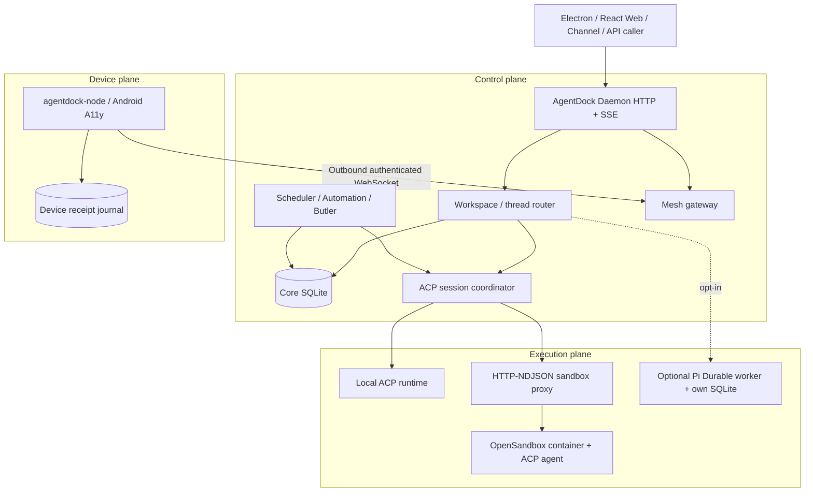

# AgentDock public architecture

An English-language entry point for the architecture implemented in this repository. The canonical architecture facts remain [docs/architecture.md](../architecture.md) and the [L1–L3 matrix](overview.md). This page introduces no new services, protocols or design commitments.

## Three boundaries



**Daemon:** `apps/daemon/` owns workspace configuration, threads, messages, run and submission state, approval state, API streams, external identities, scheduling, delivery and Mesh management. Electron only starts/manages the desktop shell. `apps/web/` uses the Daemon API through `@agentdock/sdk`.

**Agent execution:** the daemon's ACP coordinator chooses an existing compatible session or starts a new runtime. Local ACP processes and OpenSandbox containers are execution boundaries, not independent Core instances. Sandbox transport is HTTP-NDJSON. Workspace/state host mounts can survive container replacement if correctly configured; that does not imply an in-progress tool can be resumed.

**Devices:** Mesh nodes initiate outbound connections. Core maintains identity/history and dispatches scoped operations. Nodes enforce local permissions and can keep bounded operation receipts. A Mesh operation ID is **not** an ACP run ID.

## External cloud execution, end to end

```mermaid
sequenceDiagram
  participant App as External app
  participant Core as AgentDock Daemon
  participant DB as Core SQLite
  participant OS as OpenSandbox
  participant ACP as Sandboxed agent
  App->>Core: POST /external/runs (external user/project/thread, prompt)
  Core->>DB: Map external IDs; persist thread and run
  Core->>OS: Launch sandbox with workspace/state volumes
  OS->>ACP: Start agent + HTTP-NDJSON bridge
  Core->>ACP: ACP session and prompt via proxy
  ACP-->>Core: Updates, final reply
  Core->>DB: Persist output and run state
  Core-->>App: Per-run SSE snapshots / stream updates
```

The actual API endpoints are under `/api/local/v1`. `POST /external/runs` returns workspace/thread/run IDs and an `events_url`, while `GET /external/runs/:runId/events` streams a snapshot and run-specific updates. See the [API and sandbox details](cloud-sandbox-and-external-api.md) and [working demo](../demos/cloud-sandbox.md).

## Durable state vs replay safety

| State | Owner | What survives |
| --- | --- | --- |
| Workspace/thread/run, submissions, messages | Core SQLite | Product history and state |
| Traditional ACP session | Thread stores session ID; runtime owns private context | Conditional `session/load` if capability/provider/state match |
| Pi Durable checkpoints | Opt-in singleton worker with separate `pi-durable.sqlite` | Supported reconciliation keyed by stable submission IDs, not a cross-DB transaction |
| Sandbox files/state | Configured host mounts | Files subject to mount scope and host persistence |
| Mesh receipt | Device's bounded local journal | Saved result lookup; not guaranteed receipt of an effect during every crash window |

Read [Agent Session recovery](../guides/agent-session-recovery.md). Recovering messages does not mean restoring an in-flight process. Duplicate external effects must not be silently replayed.

## Trust and deployment

The Compose development example publishes ports on `127.0.0.1` and mounts the host Docker socket. That socket is a privileged capability; this configuration is **not** a hardened multi-tenant cloud service. Keep API/control endpoints private, protect model credentials and configure approvals/permission modes and Mesh capabilities explicitly.

## Code and evidence map

- ACP session state and `session/load`: `apps/daemon/src/acp/local-core-acp-session-coordinator.ts`
- Snapshot capability flags: `apps/daemon/src/acp/store/thread-execution-snapshot.ts`
- OpenSandbox: `apps/daemon/src/sandbox/`
- Mesh gateway and receipts: `apps/daemon/src/mesh/`
- External API and SSE: `apps/daemon/src/runtime/`
- Compose end-to-end integration: `scripts/e2e-compose.mjs`
- Rendered [system architecture](system-architecture.html), [ACP sequence](acp-session-flow.html), [run lifecycle](agent-run-lifecycle.html)

**Architecture Impact: None** — this is a documentation-only view of existing boundaries.
