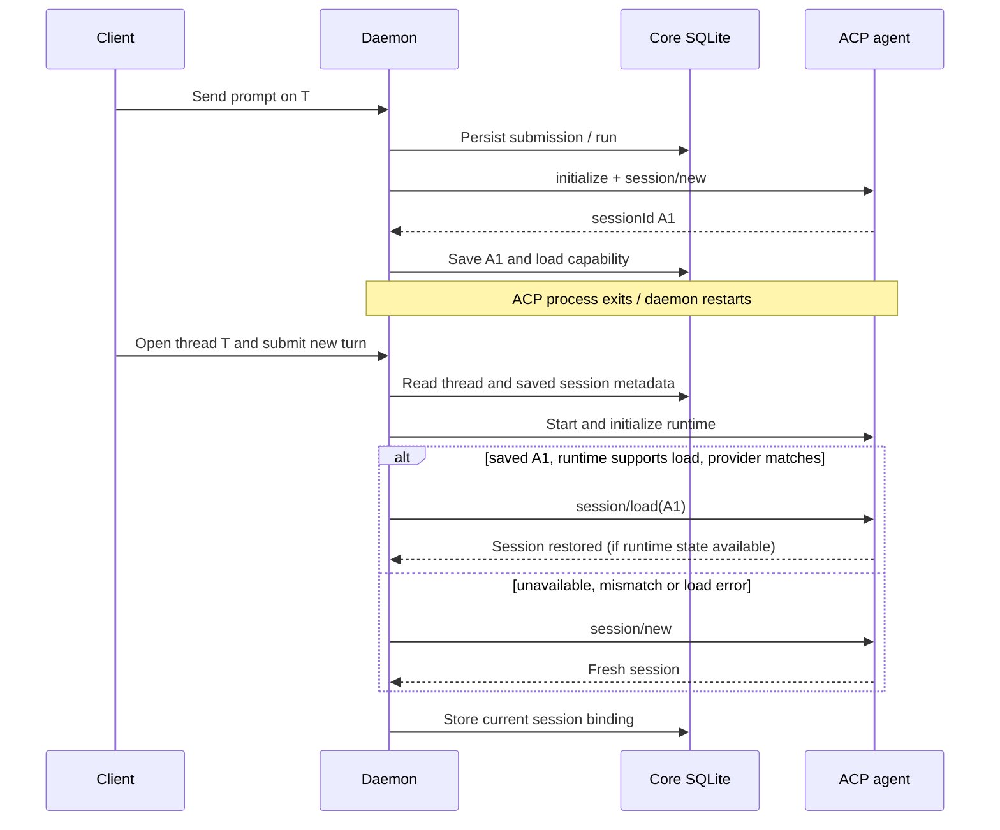

# Agent Session recovery — technical case study

**Scenario.** A user creates workspace `W`, thread `T` and submission `S1`. The daemon launches an ACP agent, which returns session ID `A1`. An ACP process later exits or the daemon restarts. The user reopens thread `T` and sends another turn.

There are three independent questions: (1) can the user read the earlier conversation, (2) can the ACP runtime reload its private session context, and (3) can an interrupted tool operation safely continue? AgentDock has different answers for each.

## What happens

In `apps/daemon/src/acp/local-core-acp-session-coordinator.ts`, `ensureSession` first reuses a compatible **live** in-memory session when possible. Otherwise it spawns/initializes an ACP transport. It attempts `session/load` only if the thread has a saved `acp_session_id`, both stored and current runtime indicate load support, and the provider configuration still matches. Failed loads fall back to `session/new`, and provider mismatches deliberately invalidate a stale session to avoid mixed-provider context.

**History remains separate.** `apps/daemon/src/acp/store/thread-execution-snapshot.ts` advertises `historyResume: true`. Its `executionResume` flag is true only for `pi-durable`; `toolReplaySafe` is false. Thread/message history can survive even if the runtime's private context cannot.

## Failure matrix

| Failure | History | ACP context | In-flight external tool |
| --- | --- | --- | --- |
| Web UI disconnect | Persisted in Core | Usually live if runtime unchanged | UI reconnect does not replay |
| ACP process exits between turns | Persisted | May reload with `session/load` | No automatic replay |
| Daemon restarts during normal ACP turn | Persisted/interruption tracked | Conditional on later reload | **Unknown effect must not be blindly retried** |
| Provider config changes | Persisted | Old binding rejected | No replay |
| Sandbox container replaced | Persisted | Conditional on state mounts and runtime load | No guaranteed continuation |
| Opt-in Pi Durable worker restart | Persisted | Checkpoint/submission reconciliation for supported subset | Not arbitrary tool replay |

## Pi Durable is a separate runtime

The optional `pi-durable` runtime uses a single ESM worker/Harness and `runtime/pi-durable.sqlite` per Core data directory; threads have separate conversations. Core and Durable SQLite do **not** share a transaction, so stable submission IDs reconcile the two stores. Its supported provider/tool subset and approvals are narrower than arbitrary ACP+sandbox execution. See [durable execution](../architecture/changes/2026-10-03-durable-execution.md) and `apps/daemon/src/agents/pi-durable/`.

Mesh recovery is different again: a stable `operationId` can locate a node-local persisted receipt after reconnect, without sending the operation a second time. A crash **before** saving a receipt can still leave the effect unknown. See [Mesh operation recovery](../architecture/changes/2026-10-25-mesh-operation-recovery.md).

## Practical validation recipe

1. Run `pnpm install && pnpm typecheck && pnpm test:ci`.
2. With a configured ACP runtime that supports `session/load`, create a thread and complete one turn. Note thread/session IDs from **private** diagnostics.
3. Stop the ACP process **between turns**, without interrupting a side-effecting tool.
4. Send another turn in the same thread and with the same runtime/provider. Inspect logs for a successful `session/load` or logged fallback to `session/new`. Confirm Core message history independently.
5. Change the provider configuration and repeat. Check that the saved old session is not reused.
6. For interrupted work, examine run/submission status and reconcile external effects **before** requesting an explicit retry.

This is a **reproducible test procedure**, not a claim that real-provider restart testing was performed in this PR. Relevant code: `apps/daemon/src/acp/local-core-acp-session-coordinator.ts`, `apps/daemon/src/acp/store/thread-execution-snapshot.ts`, `tests/integration/thread-runtime-snapshot.test.ts`.

**Rule:** recover known persisted state; never equate `session/load` with exactly-once execution.
