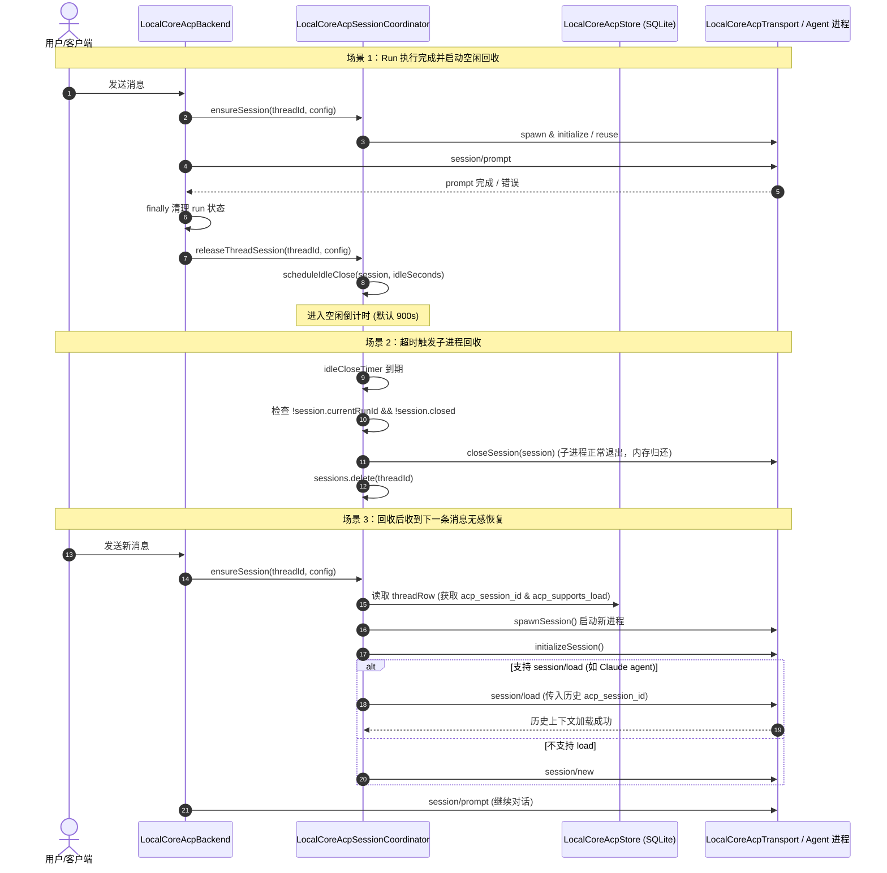

# Plan: Issue #200 Local-mode ACP 会话空闲回收与恢复

## 1. 方案流程图 (Scheme Diagram)

## 2. 详细实施步骤 (Implementation Steps)

### Step 1: 编写复现与验证测试 (TDD RED)
- 在 `tests/electron/` 下编写针对 Local 模式 ACP 会话释放与空闲回收的单元/集成测试：
  - 测试用例 1：验证 `releaseThreadSession` 在 Local 模式下会启动空闲计时器。
  - 测试用例 2：验证空闲超时到期后，`closeSession` 被调用，会话从 `coordinator` 中移除。
  - 测试用例 3：验证若会话有正在运行的 run (`currentRunId`)，空闲定时器不会误杀会话。
  - 测试用例 4：验证空闲回收后，调用 `ensureSession` 会重新 spawn 并尝试调用 `session/load` 恢复历史会话。
  - 测试用例 5：验证 `LocalCoreAcpBackend.runPrompt` 在 local 模式 run 完成后会触发 `releaseThreadSession`。

### Step 2: 修复 LocalCoreAcpBackend 与 LocalCoreAcpSessionCoordinator (TDD GREEN)
- 修改 `services/local-ai-core/src/acp/local-core-acp-backend.ts`：
  - 在 `runPrompt` 的 `finally` 块中，移除 `if (config.sandbox?.enabled)` 限制，直接调用 `this.sessionCoordinator.releaseThreadSession(threadId, config)`。
- 修改 `services/local-ai-core/src/acp/local-core-acp-session-coordinator.ts`：
  - 在 `releaseThreadSession` 中支持非沙箱模式：
    - 读取 `process.env.AGENTDOCK_ACP_IDLE_SECONDS` 或默认 900 秒。
    - 调用 `scheduleIdleClose(session, idleSeconds)`。
  - 完善 `scheduleIdleClose` 的日志与模式判定，确保日志清晰记录 `mode=local` 或 `mode=sandbox`。

### Step 3: 重构与边界防守 (TDD REFACTOR)
- 检查 `clearIdleClose` 是否在所有会话重用、强制关闭、异常断开路径中完备调用。
- 确认定时器 `unref()` 保证不会阻碍进程正常退出。
- 确认环境变量与超时秒数格式化安全性（过滤非正整数与 NaN）。

### Step 4: 架构与质量门禁验证 (QA & Gates)
- 运行完整测试套件：`pnpm typecheck`、`pnpm build:electron`、`node --test ...`。
- 运行代码规范门禁：`pnpm lint:complexity`、`pnpm lint:circular`、`pnpm lint:duplicate`。

## 3. 架构影响结论 (Architecture Impact)
- **Architecture Impact: None**
  内部优化会话管理器的资源释放策略，未改变架构层级、模块依赖或外部协议契约。
