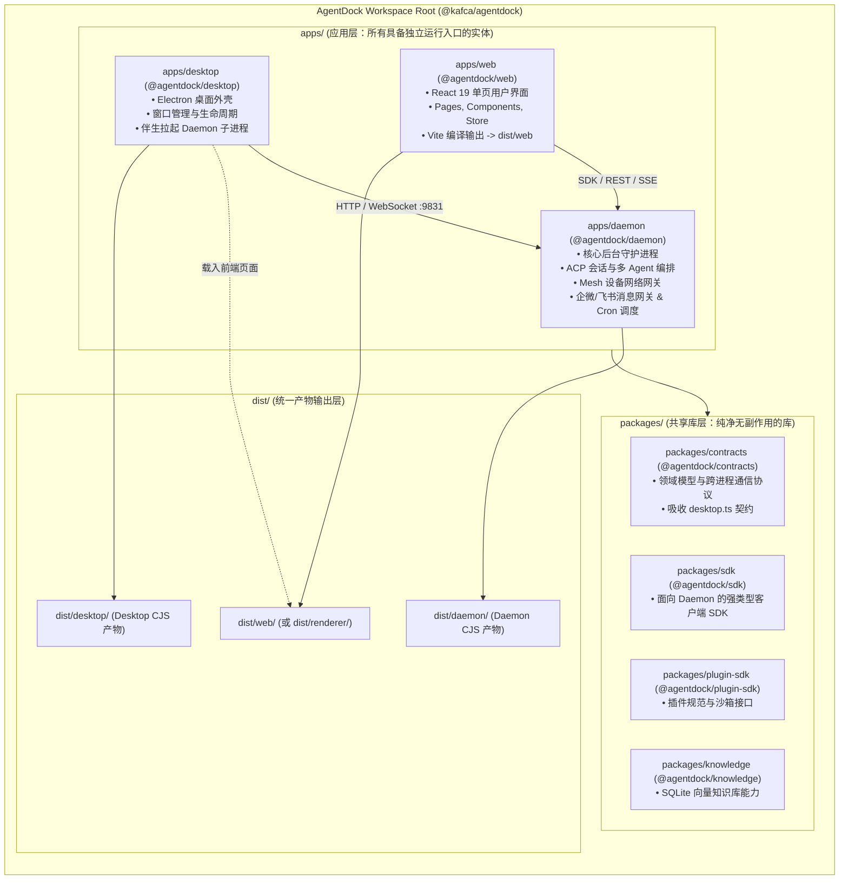

# Plan: AgentDock 终极纯粹架构实施方案（双支柱 + @agentdock/*）

> **文档标识**：`PLAN-2026-10-DAEMON-REFACTOR`  
> **关联 Spec**：`docs/specs/2026-10-17-agentdock-daemon-refactor.md`  
> **架构影响**：`Architecture Impact: Required`

---

## 1. 架构方案图（Two-Tier Pure Architecture Layout）



---

## 2. 分阶段实施路线（Phased Implementation Plan）

### Phase 1: 契约加固、共享层下沉与包名准备（Contracts & Package Scope Prep）
1. 将 `shared/desktop.ts` 迁入 `packages/contracts/src/desktop.ts`；
2. 更新 `packages/contracts/src/index.ts`，导出 `./desktop.js`；
3. 更新 `packages/contracts/package.json`（名称升级为 `@agentdock/contracts`，同时支持旧别名）；
4. 更新 `packages/core-sdk/package.json`（升级为 `@agentdock/sdk`），更新健康探针兼容逻辑；
5. 更新 `packages/plugin-sdk` 与 `packages/knowledge-api` 的包名为 `@agentdock/plugin-sdk` 与 `@agentdock/knowledge`；
6. `pnpm typecheck` 验证基础包无误。

### Phase 2: 物理目录平级重组（Git Move with Full History Tracking）
1. `git mv services/local-ai-core apps/daemon`
2. `git mv electron apps/desktop`
3. `git mv src apps/web/src`，并将根目录的 `index.html`, `public/`, `vite.config.ts`, `postcss.config.js`, `tailwind.config.ts` 迁入 `apps/web/`
4. `git mv packages/core-sdk packages/sdk`
5. `git mv packages/knowledge-api packages/knowledge`
6. 清理陈旧与冗余目录：`rm -rf apps/shell-desktop apps/shell-web services shared`
7. 更新 `pnpm-workspace.yaml` 为标准的：
   ```yaml
   packages:
     - apps/*
     - packages/*
   ```
8. 提交 Phase 2 纯文件重组提交，确保 Git Rename Detection 100% 记录历史。

### Phase 3: TypeScript 编译管线、路径别名与统一产物构建（Tooling Alignment）
1. 更新 `tsconfig.json`（根）与 `tsconfig.electron.json`：
   - `@/*` $\to$ `apps/web/src/*`
   - `@agentdock/daemon/*` $\to$ `apps/daemon/src/*`
   - `@agentdock/desktop/*` $\to$ `apps/desktop/src/*`
   - `@agentdock/contracts` $\to$ `packages/contracts/src/index.ts`
   - `@agentdock/sdk` $\to$ `packages/sdk/src/index.ts`
   - 保留旧别名作为平滑兼容（`@cc/*` 映射到新位置）；
2. 配置 `apps/web/vite.config.ts` 的 `root` 与 `outDir`；
3. 根 `package.json` 的 `main` 更新为新路径，更新 `scripts` 编译命令；
4. 适配 `bin/agentdock.mjs`、`bin/agentdock-node.mjs`、`scripts/dev.mjs`、`scripts/launch-daemon.mjs`；
5. 执行 `pnpm build` 验证编译通道通畅。

### Phase 4: 命名债务全面清理与测试套件适配（Code Refactoring & Tests）
1. 全面重构 `apps/desktop/src/main.ts` 中的 `localCore*` 命名为 `daemon*`；
2. 清理核心代码中残留的 `lac` 缩写，正名为 `agentdock`，测试并验证兼容别名；
3. 适配 `tests/` 下各层测试文件的 import 路径与断言；
4. 更新单测三项注册一致性（`package.json`、`tsconfig.electron.json`、`scripts/coverage.mjs`）；
5. 运行 `pnpm test` 与 `pnpm test:bdd`，确保全部测试通过。

### Phase 5: 架构规约、CI 质量门禁与活文档全面对齐（Archify & CI Gates）
1. 适配 `scripts/lint-metrics-common.mjs`、`scripts/lint-circular.mjs` 等静态门禁中的 `ENTRY_DIRS = ['apps', 'packages']`；
2. 更新 `knip.json` 入口配置；
3. 同步更新 `docs/architecture/system-architecture.json` 架构规范，运行 `pnpm lint:arch` 验证 9 项规格全部 PASS；
4. 更新 `AGENTS.md` 与 `README.md` 中的系统架构总览。

### Phase 6: 全量质量验收与冒烟交付（Final Verification & Smoke）
1. 执行 `pnpm verify`（全量门禁集合）；
2. 执行 `pnpm e2e:smoke` 生产打包冒烟测试；
3. 检查 git diff，准备提交归档。
