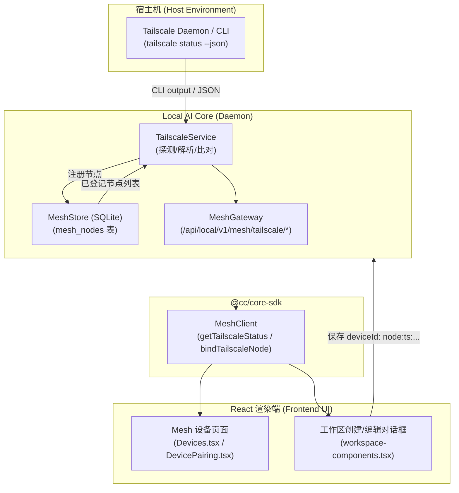

# Tailscale 节点自动发现与免配置绑定实施计划 (Plan)

## 1. 架构影响评估 (Architecture Impact)

- **结论**：`Architecture Impact: None`
- **理由**：本次变更属于 Local AI Core 中 Mesh 子系统内部的能力扩充。不改变系统核心的分层结构、ACP 会话状态机、进程边界或认证主体，仅在 MeshGateway 下增加只读探测与本地设备记录登记接口，并通过已有 Core-SDK 与 React 组件呈现。

## 2. 方案流程图 (Mermaid)

## 3. 实施步骤 (Ordered Steps)

### 步骤 1：定义共享数据契约 (`packages/contracts`)
- 文件：`packages/contracts/src/mesh.ts`
- 增加 `TailscalePeer`、`TailscaleStatusResponse`、`TailscaleBindInput` 类型导出。

### 步骤 2：编写后端服务与单元测试 (`services/local-ai-core`)
- 文件：`services/local-ai-core/src/mesh/tailscale-service.ts`
- 测试：`services/local-ai-core/test/tailscale-service.test.ts`
- 职责：
  - 查找系统 `tailscale` 路径；
  - 执行 `tailscale status --json`，设置 3000ms 超时限制与异常捕获；
  - 解析 `Self` 与 `Peer`，提取主机名、DNS 域名、Tailscale IP、OS、在线状态；
  - 与 `MeshStore.listNodes()` 做标识匹配；
  - `bindTailscaleNode`：将指定的对端信息插入 `mesh_nodes`（ID 规范为 `node:ts:<sanitized-name>`）。

### 步骤 3：路由接入与集成测试 (`services/local-ai-core`)
- 文件：`services/local-ai-core/src/mesh/mesh-gateway.ts`
- 挂载路由：
  - `GET /api/local/v1/mesh/tailscale/status`
  - `POST /api/local/v1/mesh/tailscale/bind`
- 测试：集成测试验证路由返回与绑定效果。

### 步骤 4：Core SDK 扩展 (`packages/core-sdk`)
- 文件：`packages/core-sdk/src/mesh.ts`
- 增加 `getTailscaleStatus()` 和 `bindTailscaleNode(input)` 方法。

### 步骤 5：前端 UI 增强 (`src/pages/`)
- 文件：
  - `src/pages/Mesh/Devices.tsx` 及 `DevicePairing.tsx`：增加 Tailscale 状态与在线设备列表卡片，支持一键“绑定为 Mesh 节点”；
  - `src/pages/Desktop/Workspace.tsx`、`workspace-components.tsx`、`workspace-sections.tsx`：在“Execution device”下拉列表中，展示发现的 Tailscale 在线设备，支持一键选择并自动完成绑定与设置 `deviceId: "node:ts:..."`。
- 多语言更新：`src/i18n/` 中补充对应的中英文标签。

### 步骤 6：质量门禁与全流程验证
- 运行 `pnpm typecheck`；
- 运行新增测试用例；
- 验证真实调用（本机运行 `tailscale status --json` 的解析与映射）；
- 最终代码审查与交付验收。
