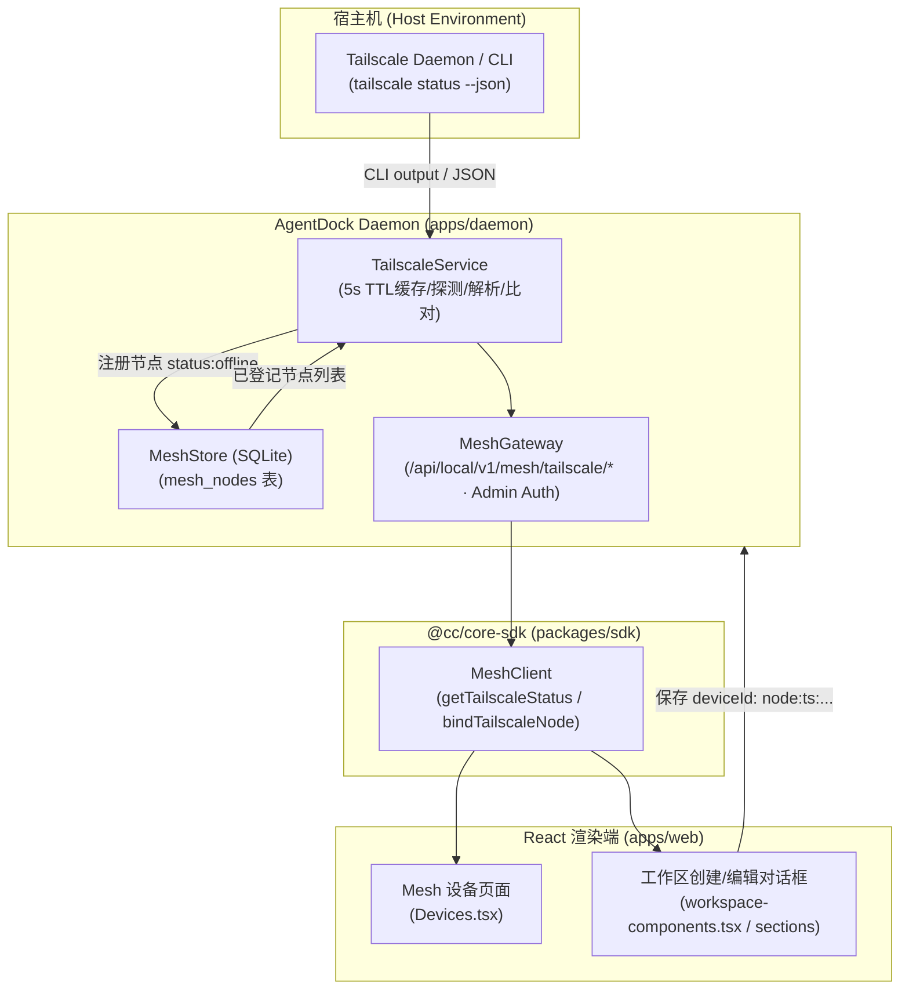

# Tailscale 节点自动发现与免配置绑定实施计划 (Plan)

## 1. 架构影响评估 (Architecture Impact)

- **结论**：`Architecture Impact: Required`
- **理由**：本次变更增加了公共端点表面（`/mesh/tailscale/status` 与 `/mesh/tailscale/bind`）、引入了外部 Tailscale 进程状态探测与 5 秒 TTL 缓存机制，并在 MeshGateway 管理鉴权下实施管理员权限校验（管理端点要求 `Authorization: Bearer <token>`）。

## 2. 方案流程图 (Mermaid)

## 3. 实施步骤 (Ordered Steps)

### 步骤 1：定义共享数据契约 (`packages/contracts`)
- 文件：`packages/contracts/src/mesh.ts`
- 增加 `TailscalePeer`、`TailscaleStatusResponse`、`TailscaleBindInput`、`sanitizeTailscaleName`、`tailscaleNodeId` 导出。

### 步骤 2：编写后端服务与单元测试 (`apps/daemon`)
- 文件：`apps/daemon/src/mesh/tailscale-service.ts`
- 测试：`tests/integration/tailscale-mesh.test.ts`
- 职责：
  - 查找系统 `tailscale` 路径（支持 `TAILSCALE_CMD`，不存在时严格报错）；
  - 执行 `tailscale status --json`，设置 3000ms 超时限制与 5s TTL 缓存/请求合并；
  - 解析 `Self` 与 `Peer`，提取主机名、DNS 域名、Tailscale IP、OS、在线状态；
  - 与 `MeshStore.listNodes()` 做标识匹配；
  - `bindTailscaleNode`：使用确定性命名工具 `tailscaleNodeId(name, dnsName)` 生成 `node:ts:<sanitized-name>`，若重复调用则幂等更新对应节点的 platform/capabilities/label 等字段，且保留初次创建时间；登记节点初始为离线登记清单记录（`status: 'offline'`, `token_hash: NULL`）；实际执行命令与派发仍需在对端通过标准的 `agentdock-node pair/connect` 流程配对接入。

### 步骤 3：路由接入与管理鉴权 (`apps/daemon`)
- 文件：`apps/daemon/src/mesh/mesh-gateway.ts`
- 挂载路由（置于 `this.authorize(req)` 保护之下）：
  - `GET /api/local/v1/mesh/tailscale/status` (需管理员 token)
  - `POST /api/local/v1/mesh/tailscale/bind` (需管理员 token)

### 步骤 4：Core SDK 扩展 (`packages/sdk`)
- 文件：`packages/sdk/src/mesh.ts`、`packages/sdk/src/runtime.ts`
- 增加 `getTailscaleStatus()` 和 `bindTailscaleNode(input)` 方法，并在 `createMeshClient` 中支持从 localStorage 自动解析 token。

### 步骤 5：前端 UI 增强 (`apps/web/src/pages/`)
- 文件：
  - `apps/web/src/pages/Mesh/Devices.tsx`：展示 Tailscale 状态与在线设备列表卡片，使用英文默认 fallback，支持一键“绑定为 Mesh 节点”；
  - `apps/web/src/pages/Desktop/workspace-components.tsx`、`workspace-sections.tsx`：在“Execution device”下拉列表中，展示发现的 Tailscale 在线设备，捕获绑定异常并在界面呈现错误，避免静默写入无效设备。
- 多语言更新：`apps/web/src/i18n/` 中补充对应的标签。

### 步骤 6：质量门禁与全流程验证
- 运行 `pnpm typecheck`；
- 运行新增测试用例（未鉴权 401、TTL 缓存、离线派发 409、TAILSCALE_CMD 路径错误）；
- 运行 `pnpm lint:gates`、`pnpm test`、`pnpm coverage`。
