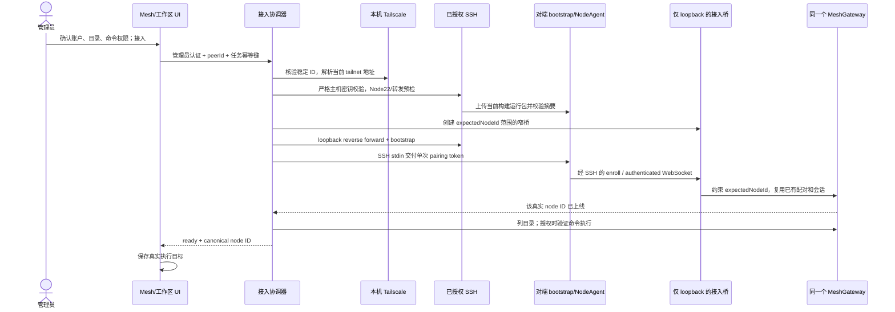

# Tailscale 设备发现与一键接入实施计划

Status: 已批准（2026-10-24）；实现与本地自动验证已完成，真实目标主机验证为 [BLOCKED]。权威需求见同名 Spec。

## 基线与架构影响

- PR #222 head：`c5f457dc081bb1fa2b9b68c61820fc57c9c15d00`。
- 独立 worktree：`/private/tmp/agentdock-tailscale-one-click`，分支 `codex/2026-10-24-tailscale-one-click`。
- 已在该 worktree 自动合入 `origin/main` `978b234`；特性与文档改动只在该隔离 worktree 内准备提交。宿主工作区中的自动化改动保持原样。
- Architecture Impact: **Required**。增加受授权的远端进程启动、SSH 部署/监督、窄接入桥、稳定 peer 映射和持久连接状态，涉及进程、网络、信任与数据边界。
- Mesh v1 节点认证/执行消息复用；增加管理编排与部署协议，不将 tailnet 设备直接视为已认证 Mesh 节点。

## Expected / Delta

新增：Onboarding Store/Manager、SSH Transport、独立 bootstrap runtime、节点范围接入桥。
保留：现有 MeshStore pair/enroll、NodeAgent、能力交集、认证、撤销和 dispatch。
替换：`node:ts:<name>` 假执行目标、吞掉失败后保存 peer ID 的选择路径。

## 独立方案比较与最终裁决

三份独立规划均建议已授权 SSH + 现有配对协议；主要分歧在运行包分发、回连和常驻方式。

| 决策 | 选定方案 | 理由 |
|---|---|---|
| 系统入口 | 标准 OpenSSH 经 tailnet | 覆盖 macOS GUI Tailscale；不假定 Tailscale SSH server 可用 |
| 运行包 | 当前构建的独立 Node22 bundle | 不依赖未发布 npm CLI；不安装完整应用或全局依赖 |
| 回连 | SSH reverse forward + expectedNodeId 窄桥 | 无需用户配置额外 HTTPS 地址/证书，不占用已有 CP Dashboard 的 Serve443，也不暴露完整 Core |
| 常驻 | Daemon 监督 SSH/远端 bootstrap | 同一生命周期可覆盖 Mac/Linux；不引入 launchd/systemd/linger 的平台准备，控制端恢复即自动重连 |
| 身份 | stable Peer.ID -> canonical node UUID | 避免名称碰撞和 PublicKey 轮换，真实会话与选择器一致 |

代价：SSH server 必须允许 loopback remote forwarding，控制端运行时维持 SSH 会话。缺失时给出具体准备项；不降级为暴露完整 Core 或自动绕过主机密钥。

## 实施顺序

1. **原型与唯一批准步骤**
   - 更新 `design/index.html` 和清单，演示首次权限确认、阶段进度、文件/命令能力差别、SSH/Node/会话失败、重试/取消及工作区目标变化。
   - 对照 Spec 验收原型，保存截图；一次确认方案与交互后进入实现。

2. **身份与持久状态**
   - contracts 定义 stable peer ID、connectionId/operationId、阶段、错误码和管理员输入/响应，分开 peer/node/operation ID 语义。
   - 独立 `tailscale-onboarding-store.ts` 或等价小模块：连接配置、controllerId、任务和租约；必要 MeshStore 方法保持身份分配与哈希凭据所有权。
   - 数据库唯一约束与事务保障每 peer 一个关联身份/活动任务；显式区分 cancelled、revoked、needs_repair。
   - 调整发现解析使用 Peer.ID，缺失稳定 ID 不可自动接入；旧 `node:ts` 保留并标记 legacy。

3. **独立 runtime 与 bootstrap**
   - 构建脚本使用直接 esbuild 开发依赖打包 NodeAgent/NodeCapabilities/credentials/ws；产物纳入 desktop/npm 打包和版本/摘要 manifest。
   - bootstrap 读取限长初始化帧，校验 controllerId/nodeId/root/policy，独占私有凭据与实例锁；调用现有 enroll 并核对返回 ID。
   - 限定创建/写入范围，防 symlink、覆盖、路径注入；保持 stdin EOF/信号退出。错误状态帧固定且脱敏。
   - 不修改既有 CLI connect 的服务器地址绑定；新 bootstrap 的持久 controllerId 与临时 tunnel URL 明确分离。

4. **节点范围接入桥**
   - 抽出 MeshGateway 可复用的受范围约束 enrollment/upgrade 入口，仍使用原有 sessions/dispatch。
   - loopback 随机端口只放行准确 enroll/connect，expectedNodeId 在凭据消耗和 WS 认证时强制检查。
   - 拒绝其余 HTTP 方法/路径、编码绕过、绝对 URL、管理与 shell 路由、其他节点的有效凭据；关闭时完整释放连接和监听。

5. **SSH Transport 与 Manager**
   - 仅后端发现地址可作为目标；固定端口22、校验用户名、禁用密码/agent转发/不受控代理与本地命令，严格 host key。
   - 检查 Node22/目录/对端控制器私有状态；上传 hash runtime；创建 ControlMaster 和动态 loopback remote forward，核验实际监听地址。
   - 配对在所有准备完成后签发，经 stdin 交付；管理端不保存明文 token。
   - 租约、状态机、有限退避、断线/控制端重启恢复、远端锁与凭据协调；撤销/取消/重新授权需要独立动作，避免注册成功但响应丢失时创建新身份。

6. **API、SDK 与 UI**
   - 管理员鉴权 create/status/cancel/disconnect/reauthorize；请求限制、敏感数据去除、操作级并发限制。
   - Mesh/Workspace 共用接入状态模型与对话组件；新 peer 选择等待 ready 后才持久化真实 nodeId。
   - 文件能力与工作区 shell 能力分开显示；已有真实离线节点准确保留，旧 synthetic 目标需重选。
   - 五语言更新；既有 token 设置沿用，认证错误不伪装为 Tailscale 未安装。

7. **文档、架构和交付**
   - 同步 `docs/architecture.md`、`docs/architecture/mesh.md`，增加2026-10-24语义变更记录。
   - 更新 L1 `system-architecture.json` 受影响边界，并新增/更新一键接入 sequence/lifecycle 规范；按 manifest 注册适用校验与 overview。
   - 使用当前 Archify 工具验证并输出实际交付图/README managed block；遵循 maintenance 的可用性报告规则。
   - README New、macOS Remote Login/Node22/SSH forwarding 准备和恢复操作文档一致；更新 PR #222 标题/正文及验证证据。

## 验证顺序与证据

按行为切片 TDD，优先证明身份、权限、秘密和恢复不变量，而非为实现细节复制测试。

1. Store/contract：唯一约束、并发双击、稳定ID、rename/key rotation、重复请求、撤销/取消竞态和中断恢复。
2. 真实 SQLite + HTTP/WebSocket + bootstrap 子进程：一次配对、expectedNodeId、私有文件、能力交集、session-ready、试执行及 EOF 退出。
3. SSH transport故障注入：未知/变化 host key、登录失败、缺 Node22、forwarding 禁止/wildcard、摘要不符、输出超限、超时和取消。注入器不能替代正式 SSH 集成。
4. 隔离 sshd/测试 key：真实上传、动态反向转发、严格 host key、窄桥、断线、控制端重启恢复；检测 argv/日志/HTTP响应/任务表秘密泄漏。
5. 原型确认后的 UI：成功才保存真实 ID；失败/取消不保存；缺少shell不显示工作区可执行；重新授权明确确认；多语言与不同页面一致。
6. 真实 macOS 与 Linux：正式界面/CLI入口完成SSH接入，读写临时测试文件、显式批准的无副作用命令、SSH断线恢复、撤销和拒绝派发。远端测试必须具备相应授权及隔离目录；无能力执行的项标记 [BLOCKED]。
7. 文档同步后独立 Review（未参与实现的 Agent）；修复有效阻塞项后运行 `pnpm verify`。避免已通过后无变化地重复整套检查。

交付必须给出 AC -> 证据映射、Actual As-Built 简图和外部环境限制，不能把假数据原型、SSH返回0或单机模拟当成双机接入成功。

## 实际实现与验证记录（2026-10-25）

- 实现：稳定 Tailscale peer ID 关联、SQLite 持久接入状态、Node 22 bootstrap bundle、SSH 监督与严格主机密钥校验、expected-node 限定的 loopback enrollment bridge、管理员 API/SDK、Mesh/Workspace 共用接入流程，以及 ready+active 校验后才允许保存执行目标。旧 inventory-only `/tailscale/bind` 返回 `410`，避免将未认证节点显示为已接入。
- 权限：`allowShell` 默认为 false，UI 显式确认；服务端只在 Mesh enrollment、认证 WebSocket、已授权目录检查和获准时的无副作用命令验证全部完成后进入 `ready`。远端 Shell 仍以设备账户的操作系统权限运行，批准目录不构成沙箱。
- [PASS] `pnpm typecheck`、renderer build、Electron/runtime bundle build；专项 Mesh onboarding、SSH transport、runtime/store 和 UI contract tests。
- [PASS] 全仓 `pnpm test` 及 BDD 在本机 loopback 访问审核通过后完成；实际结果见本计划后续更新。
- [BLOCKED] 真实双机接入没有宣称通过：隔离 sshd 集成测试默认跳过；目标 MacBook Pro 当前未在线，且该控制端尚未建立对应 SSH 主机密钥信任。执行仍要求目标在线、端口 22/loopback remote forwarding 可用，并从控制端可信的 `known_hosts` 主机身份通过严格校验。
- [N/A] 用 `ssh-keyscan` 自动接受主机密钥、`StrictHostKeyChecking=accept-new`、密码认证或绕过目标离线检查；这些路径违反已批准信任边界。
