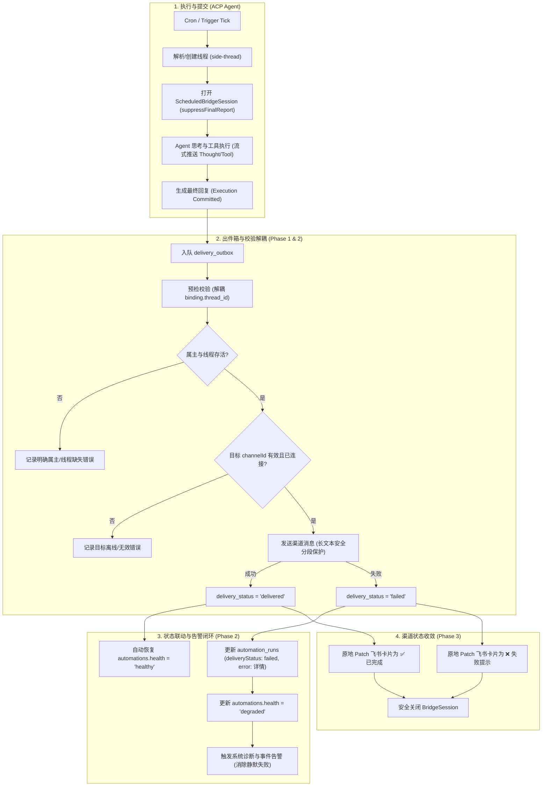

# Plan: 定时任务渠道投递韧性与终态收敛实施方案（Phase 1 - 3）

## Architecture Impact
- **Architecture Impact**: `Required`
- **Rationale**: 调整了自动化执行上下文（Thread）与出件投递目标（Channel Route）的领域边界解耦，引入了健康度降级状态（`degraded`）与 Outbox 状态联动机制，建立了渠道流式卡片与 Outbox 的终态收敛协调机制。

## 实施步骤（有序执行）

### Step 1: 契约层扩展与基础类型对齐
1. 修改 `packages/contracts/src/automations.ts`：
   - `AutomationDefinition['health']` 扩展为 `'healthy' | 'degraded' | 'blocked'`；
   - 更新 `normalizeAutomationDefinition` 与相关校验函数，兼容 `degraded`；
   - `AutomationRun` 显式增加 `deliveryError?: string`。
2. 修改 `packages/plugin-sdk/src/channels.ts`：
   - `ChannelRuntime` 声明 `finalizeScheduledThreadBridge` 可选接口。

### Step 2: Phase 1 止血与解耦（TDD 驱动）
1. 在 `tests/integration/delivery-outbox.test.ts` 中编写测试用例：
   - 验证 `side-thread` 模式下，执行线程为独立线程且无绑定/绑定到不同线程时，`deliver()` 正常成功投递到飞书聊天。
   - 运行确认红灯失败（复现原 bug）。
2. 修改 `apps/daemon/src/automation/automation-action-executor.ts`：
   - 移除 `binding?.thread_id === record.threadId` 校验；
   - 拆分为执行上下文与目标路由的双层解耦校验。
3. 运行测试验证绿灯通过。

### Step 3: Phase 2 错误分类与健康度闭环（TDD 驱动）
1. 修改 `apps/daemon/src/automation/delivery-outbox-service.ts`：
   - 细化预检错误原因，分类返回清晰错误信息。
2. 修改 `apps/daemon/src/acp/store/local-core-acp-store.ts` 与 `automation-store.ts`：
   - 在 `deliveries` 状态镜像监听中，当投递失败时，更新 `automation_runs` 的 `deliveryError` 与 `error`；
   - 将 `automations.health` 标定为 `'degraded'`。
3. 修改 `apps/daemon/src/automation/automation-service.ts` 与 `automation-schedule-utils.ts`：
   - 投递失败时触发告警广播与可观测日志；
   - 调度轮询允许 `'degraded'` 继续执行，并在下次成功时自愈为 `'healthy'`。
4. 编写对应的测试并验证绿灯。

### Step 4: Phase 3 飞书流式卡片终态收敛
1. 修改 `apps/daemon/src/scheduler/scheduled-bridge-session.ts`：
   - 引入稳定 `previewHandle` 并增加 `settle` 收敛接口。
2. 修改 `apps/daemon/src/channel/shared/base-channel-gateway.ts` 与 `apps/daemon/src/channel/lark/local-core-lark-gateway.ts`：
   - 支持根据稳定 handle 原地 Patch 初始卡片为终态（`✅` 或 `❌`）。
3. 在 `AutomationActionExecutor` 中，在 Outbox 结算后驱动收敛，最后关闭 Bridge。

### Step 5: Phase 3 超长 Markdown 文本安全分段保护
1. 在 `apps/daemon/src/channel/lark/rendering/` 实现 `splitLarkMarkdown` 并编写独立切分测试（覆盖代码块、长表格、段落分割）。
2. 在 `LocalCoreLarkGateway.sendOutboundMessage` 中集成切分逻辑，超长文本按序多条发送并汇总 messageIds。
3. 微信网关统一复用安全分段保护。

### Step 6: 架构同步与全量质量门禁验证
1. 更新 `docs/architecture/scheduled-delivery-workflow.json` 工作流规范；
2. 运行 `pnpm lint:arch` 验证架构图一致性；
3. 运行 `pnpm typecheck`、`pnpm lint:gates`、`pnpm test`，确保 100% 通过。
