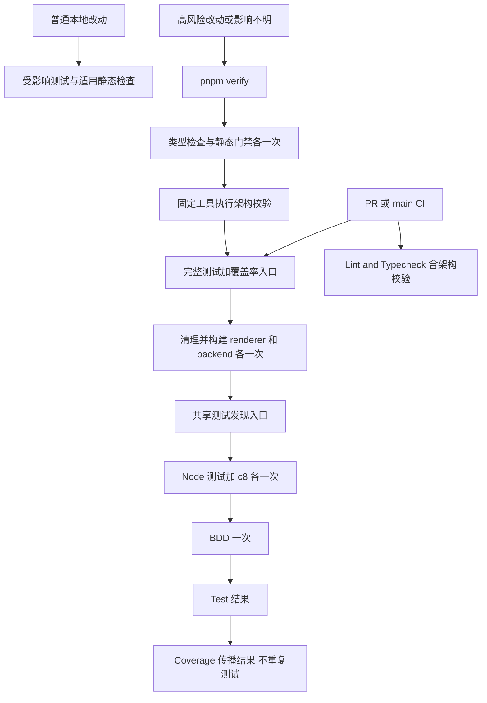

# 验证流程优化实施计划

状态：实现与独立复审完成；`pnpm verify` 被现有死代码基线阻断。日期：2026-10-24（Asia/Shanghai）。
配套规范：[Spec](../specs/2026-10-24-verification-pipeline.md)。
基线：`abfd14a243b284817d773574f7381004af91ffb2`；分支：`codex/2026-10-24-verification-pipeline`。

## Complexity

中等：涉及仓库规则、构建/测试脚本与 CI 的局部编排重构，兼容范围清楚；不修改应用协议、业务状态或运行时安全边界。

## Architecture Impact

Architecture Impact: None。

仅调整开发验证流程与现有检查的执行方式；不改变应用模块职责、依赖方向、公共协议、数据所有权、部署拓扑或运行时进程/网络边界。已阅读 `docs/architecture/maintenance.md`。系统 L1-L3 架构事实保持现状，不为此重绘业务架构。若实施发现实际边界变化，先更新影响分类和方案。

Docs Impact: Required（AGENTS、README、Spec/Plan 与最终验证记录）。

## Expected Flow

此图是设计预期；交付时基于最终代码给出实际流程与逐项验收记录。

## Ordered Steps

1. **测试先行。** 为脚本编排、共享测试集合与漏编译、失败退出、CI 状态传播写最小失败测试。现有 `tests/electron/test-registration.test.ts` 从检查重复字符串改为检验真实的发现/编译/执行一致性；不删除有效防漏约束。
2. **统一测试入口。** 增加小型 ESM 文件发现与执行模块，保持现有目录范围和 renderer 测试覆盖；普通 Node runner 与 coverage 共用。提供窄接口以注入进程执行器，测试能检查阶段次数和错误传播，无需反复启动全量套件。
3. **构建与完整验证去重。** 复用现有构建步骤并区分普通/带 source map 构建；覆盖率路径也先清理旧输出。保持独立 test/coverage 的语义，新增完整测试加覆盖率入口，verify 只调用一条完整测试路径。
4. **CI 补齐架构门禁。** 固定官方 Archify commit 并通过 ARCHIFY_BIN 使用；缺失工具、无效规范与校验失败均非零退出。CI Test 执行一次覆盖率与 BDD，Coverage 为显式结果汇总；保留原检查名称和 PR/main 触发器。
5. **规则与文档同步。** 修改 AGENTS 的提交前全量硬要求，明确适用范围与高风险例外；README 更新命令、验证规则、Archify 本地配置和 New 简要说明。同步测试脚本注释与 coverage 文档，避免旧说明。
6. **审查与真实 QA。** 读取 vibe-coding 的 documentation-sync、review、qa 参考文件；按最终 diff 检查文档影响，完成架构门禁后，召唤未参与实现的只读 Review subagent，对全部变更执行 Spec Verifier + Cleaner。修复有效问题并重测；完整验证因现有死代码基线失败，已分别运行架构、BDD 与 CI 测试入口并记录结果。

## Files / Configuration

主要涉及：`AGENTS.md`、`README.md`、`package.json`、`scripts/coverage.mjs`、新增共享构建/测试小模块、`scripts/lint-architecture.mjs`（按需）、`.github/workflows/ci.yml`、`tests/electron/test-registration.test.ts` 与相关脚本回归测试。

不修改业务 API、数据库、SDK 或 UI。固定校验工具的来源/commit 属于 CI 配置；不提交下载的工具、依赖目录或本机绝对路径。

## Testing Strategy / Validation Order

1. RED：编排次数、发现集合与遗漏编译、启动失败/非零/信号退出、CI 失败传播的针对性测试。
2. GREEN：相关回归测试通过，确认原有测试全部纳入共享入口；普通 test 与 coverage 的集合一致。
3. 使用固定 Archify 在现有规范运行 lint:arch；对临时无效 fixture 做负向验证；固定工具不可用不得报告通过。
4. 运行适用静态检查和完整 `pnpm verify`，从无 dist 产物状态验证构建前置条件，保留阶段日志和耗时证据。此次属于构建/CI 基础设施变更，仍必须本地完整验证。
5. 用子进程探针验证独立 test/coverage 与 verify 的实际编排次数及错误传播；对保留的命令执行真实主路径。对完整普通 test 如需单独再跑，仅为验证其兼容入口，不算 verify 内部重复执行。
6. 独立 Review 检查全部变更、文档和验收项；修复有效问题后重跑受影响检查。
7. 完整 diff 检查、`git diff --check`；最终报告逐项 PASS/FAIL/BLOCKED，不把本地验证说成远端 CI 已通过。

## Edge Cases

- 全新 checkout 没有 dist；覆盖率构建存在旧编译文件；renderer packaging 需要生产资源。
- renderer 新测试已存在但遗漏编译，或有编译产物但不在测试入口。
- 子命令启动失败、返回非零、被信号终止；覆盖率失败或 BDD 失败。
- Archify 未安装、来源下载失败、未知图类型、JSON 解析或 showcase 校验失败。
- CI Test 失败/取消/跳过时 Coverage 不得成功；保留现有检查名称，远端必需检查仍需用户实际配置。
- Windows pnpm 可执行名与路径空格；当前 Node 22 与本机 Node 版本不同。

## Approval / Delivery Boundary

方案已获用户确认。实现、独立 Review 和 QA 已在此 worktree 完成；除非用户后续要求，提交、推送和 PR 不在本次交付范围。

## Validation Record

### PASS

- `pnpm test:tooling`：24/24。覆盖构建与编排次数、空测试集合、renderer 登记完整性、各支持目录的测试源/编译产物双向完整性、Node 启动失败、信号取消、c8 阈值失败及 CI 结果传播。
- `pnpm typecheck`：通过。
- `pnpm lint:arch`：固定 Archify revision 校验 9 份架构图，0 失败；8 份 `.visual-check.json` 回执因没有 `diagram_type` 按现有脚本规则跳过。
- 架构负向验证：使用固定 Archify revision `25cf37080fc8b1dbe758a4efc3935b55f3327083`，设置 `ARCHIFY_BIN` 后运行 `pnpm lint:arch`；临时无效 workflow JSON 报告 `Validation failed`，汇总为 9 通过、1 失败、退出码 1。临时文件已清理。
- `pnpm test:bdd`：80 个场景、286 个步骤全部通过。
- `pnpm test:ci` 的 renderer 和 Electron/daemon 构建通过；c8 总覆盖率为 statements/lines 75.62%、branches 73.72%、functions 82.23%，达到 `.c8rc.json` 阈值。
- `pnpm verify` 中 circular、duplicate 通过；`lint:file-size`、`lint:function-length --fail --max-count 45`、`lint:complexity:gate` 已单独通过。`git diff --check` 通过。

### BLOCKED BY EXISTING BASELINE

- `pnpm verify` 在 `lint:gates` 的死代码门禁停止：Knip 当前报告 231 项，配置上限为 172，超出 59 项；脚本报告本次 git 改动文件无新增死符号。此处没有放宽门禁。
- `pnpm test:ci`：1117 个编译测试中 1116 通过、1 失败。失败来自未改动的 `tests/electron/lint-dead-code.test.ts`：它要求死代码数量不超过 200，而当前数量为 231。Node 测试因此非零退出，CI 编排按设计没有继续运行 BDD；BDD 已通过独立命令。
- 因此完整 `pnpm verify` 尚未达到全绿。修复仓库现有 Knip 阈值/基线后，应重跑 `pnpm verify` 和 `pnpm test:ci`。

### Acceptance Status

- AC1–AC6：通过；AC4 覆盖 renderer 源码登记与所有受支持测试根目录的源文件/编译产物双向校验，并覆盖启动失败、信号取消和真实 c8 覆盖率阈值失败。
- AC7：受上述仓库基线失败阻断；架构与 BDD 已独立验证，CI 测试入口已运行并记录单项基线失败。
- AC8：通过；未参与实现的独立 reviewer 复查了当前 diff，确认 AC4 补充覆盖并且没有遗留的功能缺陷。
