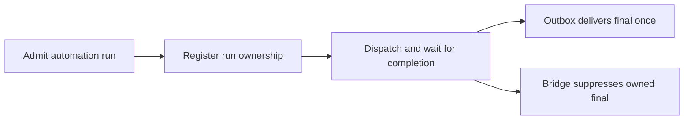

# Scheduled delivery deduplication plan

Architecture Impact: None. This restores ordering within existing automation and channel responsibilities; ownership, protocols, data flows and deployment boundaries are unchanged.

1. Reproduce late registration using automation execution and channel bridge tests.
2. Register the execution during admission before the dispatcher can claim it; preserve existing completion-time persistence and failure behavior.
3. Verify rapid completion, unrelated runs, failure cleanup and one confirmed outbox delivery; run relevant checks and independent review.

Docs Impact: None. Existing architecture and operational documentation describe the intended ownership and remain accurate.
