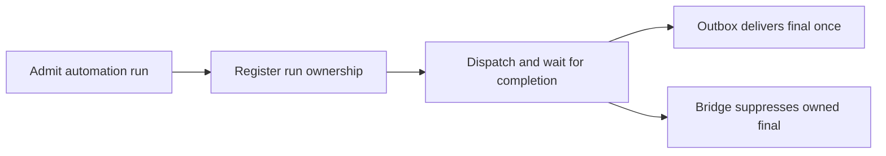

# Scheduled delivery deduplication plan

Architecture Impact: Required. Synchronous ownership registration at ACP admission changes when channel gateways hand final delivery to the outbox.

1. Reproduce late registration using automation execution and channel bridge tests.
2. Register the execution during admission before the dispatcher can claim it; preserve existing completion-time persistence and failure behavior.
3. Verify rapid completion, unrelated runs, failure cleanup and one confirmed outbox delivery; run relevant checks and independent review.

Docs Impact: Required. Synchronize the architecture facts, change record, system and scheduled-delivery diagrams, architecture matrix, and README diagram.
