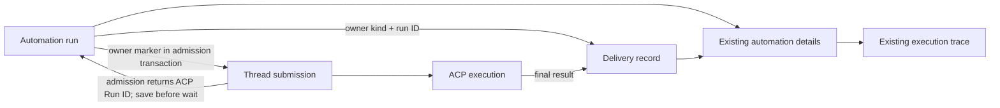

# Automation execution and delivery correlation — plan

Status: implemented; the revised prototype was confirmed on 2026-11-08. Spec: `docs/specs/2026-11-08-task-correlation.md`. Prototype: `design/index.html`. Base: f80ada7956e6d45e9f9f193a2d622ba7d0bdd677.

Architecture Impact: Required — advancing the durable association write and its restart recovery changes the data flow between automation and ACP submissions. Follow `docs/architecture/maintenance.md`; keep current architecture facts, one change record, provider artifacts, overview and README diagram aligned. This is an automation-only slice of #279, not completion of the full issue.

1. Obtain confirmation of the revised clickable prototype. Add focused failing regressions for the missing in-flight association, interruption/restart and execution-success/delivery-failure; identify exact persisted thread and workspace evidence for safe recovery.
2. Add a nullable server-owned owner kind/ID to `thread_submissions` (with an additive startup migration and unique owner index). Pass the Automation Run owner only through the internal WorkspaceRouter submission path and persist it in the admission transaction. Record the ACP run immediately after admission before waiting for completion; safely reconcile the crash window only from the matching owner, request, thread and workspace. Do not re-dispatch, trust request payloads, or link an ambiguous record.
3. Reuse automation run and delivery list APIs. Correlate delivery using exact owner kind, owner run ID and workspace; maintain old API compatibility and delivery recovery actions. Do not add an unauthenticated aggregate API or claim new principal isolation.
4. Update the existing Automation detail UI to group each run with its execution, independently show delivery status, and link the exact ACP run trace only when known. Include missing/unknown and no-external-delivery states; avoid combining separate activations.
5. Update README New section and required architecture facts, one change record, provider sources and validated artifacts. Run focused regression tests, typecheck, `pnpm lint:arch` and `pnpm verify` as required by architecture maintenance; perform independent review and real-path QA where the environment permits.
