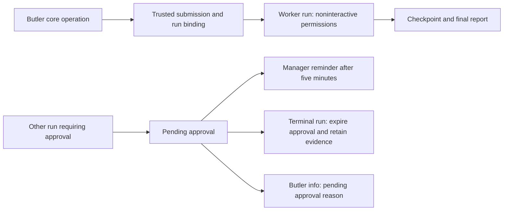

# Issue 289 implementation plan

Status: completed and verified on 2026-11-12. Base: origin/main 465079d.

Architecture Impact: Required. A run-scoped trust decision changes worker execution privileges; terminal approval cleanup, manager notifications and a public diagnostic field alter existing flows and contracts. Follow docs/architecture/maintenance.md, including current facts, one semantic change record, provider sources/artifacts, overview, README and verification.

Expected flow:

1. Trace admission, submission identity, operation/delegation binding, agent-specific permission mode launch and warm-session reuse. Design a server-owned exact-run eligibility decision that avoids dispatch/binding races and covers retry/recovery, while never granting a user-initiated turn elevated mode. Add tests first.
2. Implement the bounded per-run worker mode and verify real checkpoint/final persistence plus ordinary run isolation. Preserve independent sandbox and report capability enforcement.
3. Trace all ACP terminal, interrupt, timeout and restart paths. Add regression tests for exact-run pending expiration, resolve races and evidence preservation; implement a single well-owned lifecycle solution without altering unrelated approvals.
4. Add backwards-compatible optional diagnostic in shared contracts and Butler projection; test permission status transitions and `lac butler info --json`.
5. Reuse the persisted Butler notification/outbox path for a single five-minute reminder per pending approval with deterministic deduplication, delivery-time revalidation and existing owner/channel routing. Preserve reminders while the owner is busy; after restart, discard reminders whose old-epoch approvals were expired. Cover redaction, busy manager behavior and restart deduplication.
6. Update architecture facts, typed sources, change record, rendered artifacts, overview and README as applicable; add a concise user-visible README New note. Run architecture validation and appropriate type, build and integration tests, independent security review, and a real daemon/ACP scenario. Follow repository verification requirements for architecture impact.

Key evidence to capture: exact run and submission IDs, permission mode isolation, report persistence, expiration and race results, notification timing/deduplication, old-client compatibility, and commands/results of executed validation. Report any blocked external runtime or channel verification honestly.

## Completion evidence

- Real daemon/ACP test verifies the Core Butler request launches with `bypassPermissions`, receives ACP `selected`, leaves no pending approval, and does not persist the mode to the thread. Channel worker permission behavior remains interactive.
- Tests cover terminal expiration and late approval races, startup diagnostics, stale and batched reminder cancellation after restart, five-minute reminder deduplication, blocker visibility, and Pi Durable timeout behavior.
- `pnpm verify`: passed, including typecheck, lint gates, Archify lint (12 passed / 0 failed), 1211 compiled tests passed / 1 optional SSH test skipped, coverage thresholds, and 80 BDD scenarios / 286 steps.
- Independent review: no High or Medium findings.
