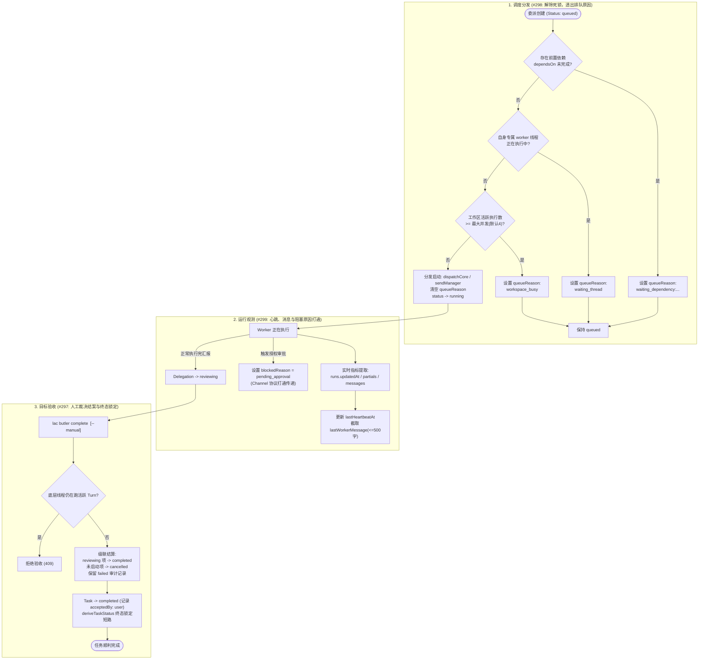

# Plan: Butler P1 管道联合修复 (#297, #299, #298)

## 1. 架构影响与判定

- **Architecture Impact**: `Required`
- **判定理由**：
  1. 共享数据契约与跨进程通信协议扩展（`packages/contracts/src/butler.ts`）；
  2. 调度执行模型由单槽位串行升级为有界并发模型，改变了任务流动机制；
  3. 任务验收生命周期引入人工裁决收拢机制，确保终态不可逆。

---

## 2. 调度与生命周期方案图 (Expected Delta)

---

## 3. 有顺序的实施步骤

### Step 1: 契约与协议层扩展
- **涉及文件**：
  - `packages/contracts/src/butler.ts`
  - `apps/daemon/src/butler/butler-bot-protocol.ts`
- **关键变动**：
  - `ButlerDelegation` 扩展 `lastHeartbeatAt`、`lastWorkerMessage`、`queueReason`、`blockedReason`、`approvals`。
  - `ButlerCompleteInput` 扩展 `manual?: boolean`、`reason?: string`。
  - `ButlerTask` 扩展 `acceptedBy?: 'user' | 'worker_report'`、`manualAcceptanceReason?: string`。
  - `ButlerBotProtocolMessage` 扩展 `blockedReason` 编解码。

### Step 2: TDD 验收修复与终态锁定 (#297)
- **涉及文件**：
  - `apps/daemon/src/butler/butler-service.ts`
  - `apps/daemon/src/butler/butler-dispatcher.ts`
  - `apps/daemon/src/cli/butler-cli-handlers.ts`
  - `tests/integration/butler-service.test.ts`
- **实施内容**：
  - 编写失败测试：测试混合状态（包含 reviewing/cancelled/failed）任务通过 `complete` 结案；测试后台 `reconcile` 不回退为 failed。
  - 重构 `ButlerService.complete()` 准入逻辑：支持直接验收与 `--manual` 选项，级联晋升 `reviewing` -> `completed`。
  - 在 `deriveTaskStatus` 与 `aggregate` 头部加入 `if (['completed', 'cancelled'].includes(task.status)) return task.status;` 终态锁定。
  - 跑通测试。

### Step 3: TDD 执行观测性与 Channel BlockedReason 贯通 (#299)
- **涉及文件**：
  - `apps/daemon/src/butler/butler-observation.ts`
  - `apps/daemon/src/butler/butler-dispatcher.ts`
  - `apps/daemon/src/cli/butler-cli-handlers.ts`
  - `tests/integration/butler-service.test.ts`
  - `tests/electron/lac-cli-butler.test.ts`
- **实施内容**：
  - 编写失败测试：验证 Core 模式观测提取心跳与助手流式片段；验证 Channel 模式下 `task.progress` 携带并持久化 `blockedReason`。
  - 在 `observeDelegation` 中从 `runs.updatedAt`、`thread_runtime_partials` 和 `messages` 计算 `lastHeartbeatAt` 与 `lastWorkerMessage`，收集 `approvals` 详情。
  - 在 `sendProgress` 与 `applyManagerProgress` 中传递并保存 `blockedReason`。
  - CLI `lac butler info` 结构化呈现新增观测字段。
  - 跑通测试。

### Step 4: TDD 解除工作区串行饥饿与排队显式化 (#298)
- **涉及文件**：
  - `apps/daemon/src/butler/butler-observation.ts`
  - `apps/daemon/src/butler/butler-dispatcher.ts`
  - `apps/daemon/src/cli/butler-cli-handlers.ts`
  - `tests/integration/butler-service.test.ts`
- **实施内容**：
  - 编写失败测试：同工作区两个无依赖的委派能同时进入 `running`；排队委派在 info 中显示准确的 `queueReason`。
  - 改造 `workspaceBusy` 为有界并发检测（排除非执行类提交，默认最大并发 4）。
  - 在 `dispatchReady` 中计算并更新 `queueReason`（`waiting_dependency` / `waiting_thread` / `workspace_busy`），分发后清空。
  - 调整 `deferCheckForBusyWorkspace` 为线程级判断。
  - 跑通测试。

### Step 5: 架构变更记录与全量验证
- 生成 `docs/architecture/changes/2026-11-15-butler-pipeline-fixes.md`。
- 运行 `pnpm build:electron`。
- 运行编译后测试套件：`pnpm test:compiled`。
- 运行 `pnpm typecheck`。
- 执行架构门禁检查。
